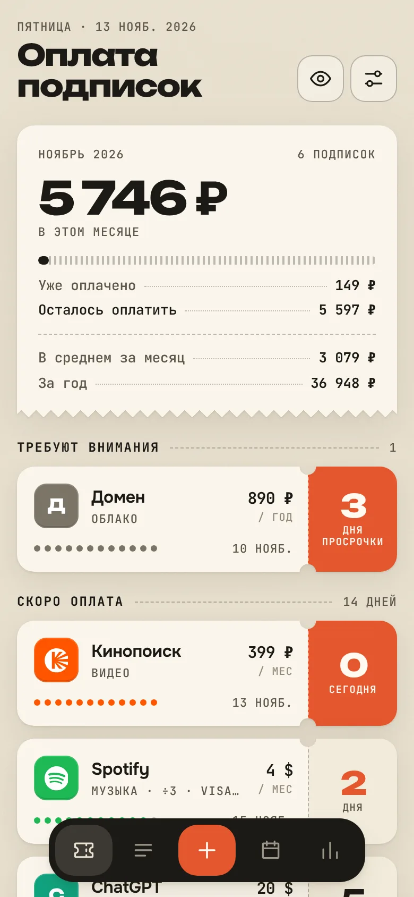
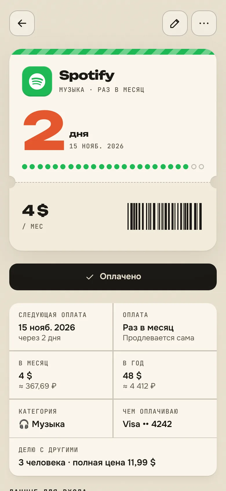
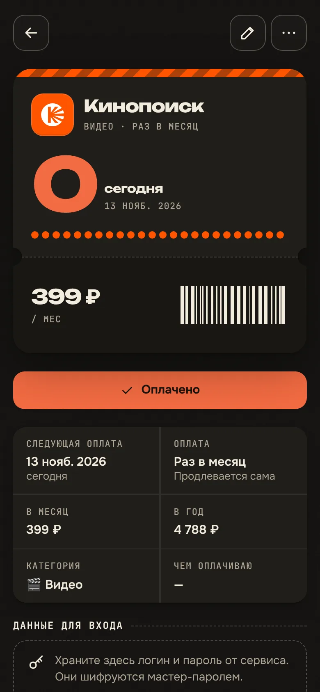

# Оплата подписок · Subscription Payments · 订阅付款

**Все ваши подписки в одном месте: сколько дней до оплаты, сколько уходит в месяц и где лежит пароль.**

Каждая подписка выглядит как билет с отрывным корешком, на котором крупно написано, сколько дней осталось до списания.
Без регистрации и облака: всё хранится только на вашем устройстве.

### [Открыть приложение](https://subscription-payments.whiskm.workers.dev/) · [Скачать для Android, Windows и Linux](../../releases/latest)

iPhone · Android · Windows · Linux · любой браузер &nbsp;|&nbsp; Русский · English · 中文

<table>
  <tr>
    <td></td>
    <td></td>
    <td></td>
  </tr>
  <tr>
    <td></td>
    <td></td>
    <td></td>
  </tr>
</table>

> **EN.** Keep every subscription in one place: days left until each payment, what you spend per month, and your logins under a master password. Each subscription is a ticket whose tear-off stub counts down to the next charge. No sign-up, no cloud: everything stays on your device. Russian, English and Chinese. **[Open the app](https://subscription-payments.whiskm.workers.dev/)** · **[Download for Android, Windows, Linux](../../releases/latest)** · on iPhone: Safari → Share → Add to Home Screen.
>
> **中文.** 把所有订阅放在一个地方：距离每次付款还有几天、每月花了多少、登录信息由主密码保护。每个订阅都是一张票，票根上显示距离下次扣款的天数。无需注册，没有云端，所有数据只保存在你的设备上。支持俄语、英语和简体中文。**[打开应用](https://subscription-payments.whiskm.workers.dev/)** · **[下载 Android、Windows、Linux 版](../../releases/latest)** · iPhone：Safari → 分享 → 添加到主屏幕。

## Установка

| Устройство | Как установить |
|---|---|
| **iPhone и iPad** | Открыть сайт в Safari → «Поделиться» → «На экран „Домой“» |
| **Android** | Скачать `subscription-payments.apk` из [последнего релиза](../../releases/latest) |
| **Windows 10 и 11** | Скачать и запустить `…_x64-setup.exe` из [последнего релиза](../../releases/latest) |
| **Linux** | Скачать `.deb`, `.rpm` или `.AppImage` из [последнего релиза](../../releases/latest) |
| **Любой компьютер** | Просто [открыть сайт](https://subscription-payments.whiskm.workers.dev/) в браузере |

<b>iPhone и iPad</b>: подробно

App Store не нужен:

1. Откройте в **Safari**: **[subscription-payments.whiskm.workers.dev](https://subscription-payments.whiskm.workers.dev/)**.
2. Нажмите «Поделиться», затем **«На экран „Домой“»**.
3. Приложение откроется как обычное, на весь экран, и будет работать без интернета.

С экрана «Домой» Safari хранит данные приложения гораздо надёжнее, чем у обычного сайта, поэтому лучше пользоваться именно значком.

<b>Android</b>: подробно

1. Откройте [последний релиз](../../releases/latest) и скачайте `subscription-payments.apk`.
2. Откройте файл. Если телефон спросит, разрешите установку из этого источника.

Новые версии ставятся так же, поверх старой: данные сохраняются.

<b>Windows</b>: подробно

1. Откройте [последний релиз](../../releases/latest) и скачайте файл, который заканчивается на `_x64-setup.exe`.
2. Запустите его. Права администратора не нужны.
3. Если Windows покажет «Система Windows защитила ваш компьютер», нажмите **«Подробнее» → «Выполнить в любом случае»**. Так бывает с любой программой без платной цифровой подписи.

После закрытия окна приложение остаётся в трее (возле часов), чтобы напоминать об оплатах. Выйти можно через меню значка в трее.

<b>Linux</b>: подробно

В [последнем релизе](../../releases/latest) есть три варианта:

| Файл | Для каких систем |
|---|---|
| `.deb` | Ubuntu, Debian, Linux Mint, Pop!_OS: `sudo apt install ./Subscription-Payments_*.deb` |
| `.rpm` | Fedora, openSUSE: `sudo dnf install ./Subscription-Payments-*.rpm` |
| `.AppImage` | Любой дистрибутив без установки: `chmod +x *.AppImage && ./Subscription-Payments_*.AppImage` |

Значок в трее работает в GNOME (с расширением AppIndicator, в Ubuntu оно уже включено), KDE, Cinnamon, XFCE и большинстве других окружений.

## Что умеет

**Подписки**
- **Быстрое добавление.** Начните вводить название, и приложение предложит один из 100+ сервисов с логотипом: Кинопоиск, Яндекс Плюс, Netflix, Spotify, ChatGPT, iCloud, 爱奇艺, 哔哩哔哩 и другие. Любой свой сервис тоже можно добавить.
- **Любой период оплаты**: неделя, месяц, квартал, полгода, год или «каждые N дней».
- **Пробный период, пауза, отмена.** Пробные подписки отмечены штампом, а отменённые видны, пока не закончится оплаченный доступ.
- **Автопродление.** После даты оплаты подписка сама переходит на следующий период. Для того, что продлевается вручную (домен, оплата картой), есть кнопка «Продлено».
- **Общие и семейные подписки.** Укажите, на сколько человек делится цена, и в расходах будет учитываться только ваша доля.
- Способ оплаты, ссылка на страницу отмены, заметки, история цен и платежей.

**Обзор расходов**
- **Главный экран в виде чека**: сколько уйдёт в этом месяце, сколько уже оплачено и сколько осталось.
- **Ближайшие оплаты** с отсчётом дней. Просроченные и сегодняшние сразу видны.
- **Календарь** всех списаний по дням.
- **Статистика**: на что уходят деньги, прогноз на 12 месяцев, самые дорогие подписки, сколько экономят общие подписки и паузы.
- **Разные валюты**: подписки в долларах, рублях, юанях и других валютах пересчитываются в основную.

**Логины и пароли**
- Логин, пароль и заметка к каждому сервису, под мастер-паролем.
- Генератор надёжных паролей. Через 30 секунд после копирования пароля буфер обмена очищается, если приложение открыто.
- Пароли запираются сами, если приложение долго не используется. По желанию можно спрашивать мастер-пароль при каждом запуске.

**Под себя**
- Русский, английский или китайский язык; своё название приложения (например, «SP»).
- Светлая и тёмная тема, цвет акцента, компактный режим, формат даты, первый день недели.
- Режим «Скрывать суммы», чтобы открывать приложение при людях.
- Свои категории со значками и цветами.

## Ваши данные

**Всё хранится только на вашем устройстве.** Нет регистрации, серверов, рекламы и аналитики. Никто, кроме вас, не видит ваши подписки.

- **Пароли** зашифрованы мастер-паролем (AES-256), а сам он нигде не сохраняется. Если его забыть, сохранённые логины не восстановит никто, но сами подписки останутся.
- **В интернет** приложение выходит только за курсами валют, и только если у вас есть подписки в другой валюте. Запрос не содержит ничего о вас. Это можно выключить в настройках.
- **На Android** данные приложения не попадают в резервные копии Google и не переносятся на другой телефон без вашего ведома.

### Резервные копии

Раз данные хранятся только на устройстве, важно иногда делать копию. Приложение напомнит об этом раз в 1, 2, 3 или 7 дней (**Настройки → Резервные копии**):

| Где | Как делается копия |
|---|---|
| Android, Windows, Linux | Сама, без вашего участия, в папку `Документы/SubscriptionPayments`. Хранятся последние 3, 5 или 10 копий |
| iPhone и браузер | В назначенный день появляется напоминание: одно нажатие, и копия сохраняется в «Файлы», iCloud Drive или отправляется вам в мессенджер |

Копию можно целиком зашифровать мастер-паролем (**Шифровать копии**).

### Перенос на другое устройство

1. На старом устройстве: **Настройки → Данные → Экспорт → Файл копии** (или **Зашифрованная копия**).
2. Перешлите файл себе любым способом.
3. На новом устройстве: **Настройки → Данные → Импорт из копии** (или кнопка «У меня есть резервная копия» при первом запуске).

При импорте можно добавить подписки к уже существующим (повторы пропускаются) или заменить всё.

Ещё есть экспорт в таблицу для Excel (без логинов) и **Добавить в мой календарь**: все оплаты с напоминаниями попадут в календарь телефона.

## Напоминания об оплате

Включаются в **Настройки → Напоминания**: можно выбрать, за сколько дней предупреждать, в том числе для каждой подписки отдельно.

| Где | Как приходят |
|---|---|
| **Android** | Уведомление в выбранное время, даже если приложение закрыто |
| **Windows и Linux** | Уведомление в выбранное время, пока приложение запущено или свёрнуто в трей. Включите **Запускать при входе в систему**, и оно будет тихо запускаться в трее вместе с компьютером |
| **iPhone и браузер** | Браузер не может напоминать сам, поэтому уведомление появляется при открытии приложения. Для надёжных напоминаний нажмите **Добавить в мой календарь** |

## Частые вопросы

<b>Нужна регистрация?</b>

Нет: открыли и пользуетесь. Аккаунтов нет вообще, приложение не показывает рекламу и не собирает данные.

<b>Нужен ли интернет?</b>

Нет. После первого открытия приложение работает без интернета. Интернет нужен только для обновления курсов валют, если у вас есть подписки в разных валютах.

<b>Можно пользоваться на телефоне и на компьютере одновременно?</b>

Да, но данные между устройствами не синхронизируются сами: так они и остаются только у вас. Чтобы перенести их, сделайте экспорт на одном устройстве и импорт на другом (см. [Перенос на другое устройство](#перенос-на-другое-устройство)).

<b>Я забыл мастер-пароль</b>

Восстановить его нельзя: он нигде не хранится, и именно поэтому ваши пароли в безопасности. Подписки останутся на месте. Удалите мастер-пароль в **Настройки → Пароли и приватность** (сохранённые логины при этом удалятся) и задайте новый.

<b>На iPhone пропали данные</b>

Safari иногда очищает данные сайтов, которые давно не открывали, особенно если сайт открыт во вкладке, а не со значка на экране «Домой». Восстановите последнюю копию через **Импорт из копии** и пользуйтесь приложением со значка: так данные хранятся надёжнее. И включите напоминания о резервных копиях.

<b>Почему Windows предупреждает при установке?</b>

Windows так встречает любую программу без платного сертификата подписи. Нажмите **«Подробнее» → «Выполнить в любом случае»**.

<b>Как обновить приложение?</b>

- **iPhone и браузер** обновляются сами при следующем открытии.
- **Android, Windows, Linux**: скачайте новую версию из [последнего релиза](../../releases/latest) и установите поверх старой. Данные сохранятся.

## Благодарности

- Логотипы сервисов — [Simple Icons](https://simpleicons.org) (CC0 1.0). Названия и логотипы принадлежат их владельцам и используются только для того, чтобы узнать сервис.
- Шрифты [Unbounded](https://github.com/googlefonts/unbounded), [Onest](https://github.com/simpals/onest) и [JetBrains Mono](https://github.com/JetBrains/JetBrainsMono) — SIL Open Font License 1.1.
- Курсы валют — [fawazahmed0/exchange-api](https://github.com/fawazahmed0/exchange-api).

---

Разработчикам: как собрать приложение и выпускать версии — в [docs/DEVELOPMENT.md](docs/DEVELOPMENT.md).
