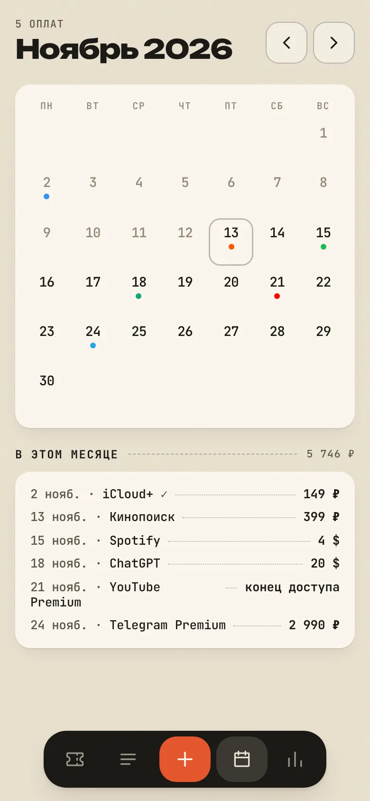
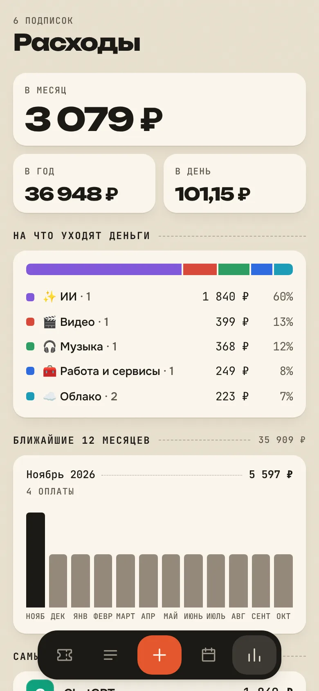
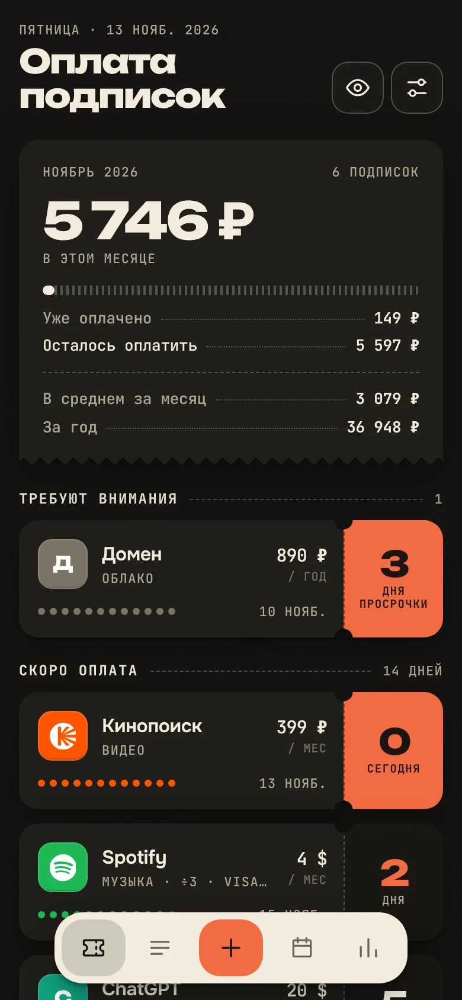

<div align="center">


# Оплата подписок · Subscription Payments · 订阅付款

**Каждая подписка — билет с отрывным корешком, на котором видно, сколько дней осталось до оплаты.**

Веб-приложение (PWA) на Cloudflare Pages, Android-приложение из GitHub Releases и iPhone через «На экран Домой».
Все данные хранятся только на устройстве.

[Возможности](#возможности) · [Приватность](#приватность) · [Установка](#установка) · [Деплой на Cloudflare](#деплой-на-cloudflare-pages) · [Android-релизы](#выпуск-android-версии) · [Разработка](#разработка)

</div>

<table>
  <tr>
    <td></td>
    <td></td>
    <td></td>
  </tr>
  <tr>
    <td></td>
    <td></td>
    <td></td>
  </tr>
</table>

> **EN.** A local-first subscription tracker. Each subscription is a ticket whose tear-off stub counts down to the next payment. Spending stats, a payment calendar, encrypted logins, reminders, JSON/CSV/ICS export and import. Russian, English and Chinese. No accounts, no servers: everything stays on the device.
>
> **中文.** 本地优先的订阅管理应用。每个订阅都是一张票，票根上显示距离下次付款的天数。支持支出统计、付款日历、加密保存登录信息、提醒、JSON/CSV/ICS 导入导出。支持俄语、英语和简体中文。无需账号，没有服务器，所有数据只保存在设备上。

## Возможности

**Подписки**
- Каталог из 100+ сервисов с логотипами и цветами: Кинопоиск, Яндекс Плюс, Netflix, Spotify, ChatGPT, iCloud, 爱奇艺, 哔哩哔哩 и другие. Работает офлайн. Можно добавить любую свою.
- Любой период: неделя, месяц, квартал, полгода, год или «каждые N дней/недель/месяцев».
- Статусы: активна, пробный период, на паузе, отменена (видна, пока не закончится доступ).
- Автопродление: после даты оплаты подписка сама переходит на следующий период и записывает платёж в историю. Для ручных подписок (домен, оплата картой вручную) есть кнопка «Продлил(а)».
- Корректные даты: подписка от 31-го числа в феврале списывается 28-го, а в марте снова 31-го.
- Общие и семейные подписки: цена делится на N человек, в расходах учитывается только ваша доля.
- Способ оплаты, ссылка на управление или отмену, заметки, история цен и платежей.
- Свои напоминания для каждой подписки или общие из настроек.

**Обзор**
- Главный экран в виде чека: сколько уйдёт в этом месяце, сколько уже оплачено и сколько осталось, средний расход в месяц и в год.
- Билеты ближайших оплат с отсчётом дней; просроченные и сегодняшние выделены штампом.
- Календарь оплат с пролистыванием месяцев свайпом.
- Статистика: расходы по категориям, прогноз на 12 месяцев, самые дорогие подписки, сколько экономят общие подписки и паузы.
- Несколько валют с пересчётом в основную. Курс обновляется раз в день или вводится вручную.

**Логины и пароли**
- Логин, пароль и заметка к каждому сервису, зашифрованные мастер-паролем (AES-256-GCM, ключ из PBKDF2-SHA-256, 600 000 итераций).
- Генератор надёжных паролей; после копирования пароля буфер очищается через 30 секунд.
- Хранилище запирается само, когда приложение долго в фоне. По желанию можно спрашивать мастер-пароль при каждом запуске.

**Данные**
- Экспорт в JSON (пароли внутри остаются зашифрованными), в полностью зашифрованный JSON, в CSV для Excel (без логинов) и в календарь (.ics с напоминаниями).
- Импорт с выбором «добавить к моим данным» (без дублей) или «заменить всё». Логины переносятся даже между устройствами с разными мастер-паролями.
- Напоминание о резервной копии раз в 1, 2, 3 или 7 дней (см. ниже, как это работает на каждой платформе).

**Настройки**
- Первая настройка при запуске: язык, валюта, название, тема, напоминания и резервные копии.
- Язык: русский, английский, китайский. Название приложения меняется вместе с языком, или можно задать своё, например «SP».
- Тема (системная, светлая, тёмная), цвет акцента, плотность интерфейса, формат даты, первый день недели.
- Режим «скрыть суммы», чтобы открывать приложение при людях.
- Свои категории с эмодзи и цветом.

## Приватность

- **Нет аккаунтов, серверов и аналитики.** Подписки хранятся в IndexedDB браузера или в WebView Android-приложения.
- Единственный сетевой запрос — загрузка открытой таблицы курсов валют ([fawazahmed0/exchange-api](https://github.com/fawazahmed0/exchange-api)). О вас и ваших подписках ничего не отправляется. Автообновление курсов можно выключить.
- Мастер-пароль нигде не сохраняется. Если его забыть, логины не восстановит никто; сами подписки останутся.
- В Android-приложении отключено резервное копирование в Google Drive и перенос данных на другое устройство: данные не покидают телефон.
- Для веб-версии настроены строгие заголовки безопасности (`public/_headers`): CSP, запрет встраивания во фреймы, `no-referrer`.

## Резервные копии и автоочистка

Браузеры, особенно Safari, иногда удаляют данные сайтов, когда мало места или сайт давно не открывали. Поэтому приложение просит браузер о постоянном хранилище и регулярно напоминает о копии:

| Платформа | Как делается копия |
|---|---|
| Android-приложение | Полностью автоматически, в `Документы/SubscriptionPayments`. Хранится 3, 5 или 10 последних копий |
| Chrome / Edge на компьютере | Один раз выбираете файл, дальше приложение само его перезаписывает |
| iPhone (PWA) и другие браузеры | В назначенный день на главном экране появляется плашка: одно нажатие, и копия сохраняется в «Файлы», iCloud Drive или отправляется себе |

Копию можно зашифровать целиком мастер-паролем.

## Напоминания об оплате

- **Android:** локальные уведомления в выбранное время за выбранное число дней, даже если приложение закрыто.
- **Веб и iPhone:** без сервера браузер не может прислать уведомление сам, поэтому оно показывается при открытии приложения. Чтобы напоминания приходили всегда, нажмите «Добавить в мой календарь»: оплаты вместе с напоминаниями попадут в календарь телефона.

## Установка

### iPhone и iPad

App Store не нужен:

1. Откройте адрес приложения в **Safari**.
2. Нажмите «Поделиться», затем **«На экран „Домой“»**.
3. Приложение откроется как обычное, на весь экран, и будет работать без интернета.

> С экрана «Домой» Safari хранит данные приложения гораздо надёжнее, чем у обычного сайта.

### Android

1. Откройте [Releases](../../releases) и скачайте `subscription-payments.apk`.
2. Разрешите установку из этого источника, когда телефон спросит.

Можно также открыть веб-версию в Chrome и выбрать «Установить приложение».

### Компьютер

Откройте веб-версию в Chrome или Edge и нажмите значок установки в адресной строке, или просто пользуйтесь во вкладке.

## Деплой на Cloudflare Pages

Приложение статическое: после сборки это просто файлы из папки `dist`. Маршруты работают через `#`, поэтому настраивать перенаправления не нужно.

### Вариант 1: Git-интеграция Cloudflare (проще всего)

1. В панели Cloudflare: **Workers & Pages → Create → Pages → Connect to Git**, выберите этот репозиторий.
2. Настройки сборки:
   - Framework preset: `None`
   - Build command: `npm run build`
   - Build output directory: `dist`
   - Переменная окружения: `NODE_VERSION` = `22`
3. **Save and Deploy.** Каждый push в `main` будет выкладываться автоматически, а для других веток Cloudflare создаст предпросмотр.

### Вариант 2: через GitHub Actions

Workflow `.github/workflows/deploy.yml` выкладывает `main` сам, если в репозитории заданы секреты (**Settings → Secrets and variables → Actions**):

| Секрет | Где взять |
|---|---|
| `CLOUDFLARE_API_TOKEN` | My Profile → API Tokens → Create Token, шаблон «Edit Cloudflare Workers» или право `Cloudflare Pages: Edit` |
| `CLOUDFLARE_ACCOUNT_ID` | Правая колонка на главной странице панели Cloudflare |

Имя проекта по умолчанию `subscription-payments`; другое можно задать переменной `CLOUDFLARE_PROJECT`. Проект создаётся один раз: `npx wrangler pages project create subscription-payments`. Без секретов workflow просто пропускается.

## Выпуск Android-версии

APK собирает GitHub Actions (`.github/workflows/android.yml`):

- на каждый push — проверочная сборка, APK лежит в артефактах запуска;
- на тег вида `v1.2.3` — сборка и публикация в **Releases**.

### Ключ подписи (один раз)

Android устанавливает обновление поверх старой версии, только если обе подписаны одним ключом. Создайте его один раз и сохраните в секретах:

```bash
keytool -genkeypair -v -keystore release.jks -alias subscriptions \
  -keyalg RSA -keysize 4096 -validity 10000

base64 -w0 release.jks > release.jks.base64   # на macOS: base64 -i release.jks
```

| Секрет | Значение |
|---|---|
| `ANDROID_KEYSTORE_BASE64` | содержимое `release.jks.base64` |
| `ANDROID_KEYSTORE_PASSWORD` | пароль хранилища |
| `ANDROID_KEY_ALIAS` | `subscriptions` |
| `ANDROID_KEY_PASSWORD` | пароль ключа |

Храните `release.jks` и пароли в надёжном месте: без них нельзя выпустить обновление, которое встанет поверх установленного. Пока секретов нет, собирается отладочный APK.

### Новая версия

```bash
npm version patch          # 0.1.0 → 0.1.1, версия попадёт и в Android
git push --follow-tags
```

`versionName` и `versionCode` Android берутся из `package.json`.

## Разработка

Нужен Node.js 22.

```bash
npm ci
npm run dev          # http://localhost:5173
npm test             # юнит-тесты: даты, расчёты, шифрование, импорт
npm run typecheck
npm run build        # веб-версия в dist/
```

Android (нужны Android Studio и JDK 21):

```bash
npm run android:sync # сборка для приложения и копирование в android/
npx cap open android # открыть в Android Studio
```

Служебные скрипты:

```bash
npm run icons                     # обновить логотипы сервисов из Simple Icons
node scripts/render-icons.mjs     # перерисовать иконки приложения из assets/*.svg
npx capacitor-assets generate --android --iconBackgroundColor '#E4572E' --splashBackgroundColor '#EBE3D3'
```

### Стек

React 19 · TypeScript · Vite · [Motion](https://motion.dev) для анимаций · Dexie (IndexedDB) · Web Crypto API · vite-plugin-pwa (Workbox) · Capacitor 8 для Android. Дизайн-система своя, без готовых UI-китов: бумажные билеты с вырубкой через CSS-маски, чеки с зубчатым краем, штампы и перфорация вместо полос прогресса.

### Структура

```
src/
  lib/          логика без интерфейса: даты, расписание, расчёты, шифрование, копии, экспорт
  data/         каталог сервисов и логотипы
  i18n/         переводы: en.ts (эталон), ru.ts, zh.ts
  state/        контексты: настройки и данные, хранилище паролей, диалоги, роутер
  components/   билет, листы, элементы форм, иконки
  screens/      экраны
  styles/       дизайн-токены и стили
tests/          юнит-тесты (Vitest)
android/        проект Capacitor
public/         иконки, заголовки Cloudflare
```

### Новый язык

Скопируйте `src/i18n/ru.ts`, переведите строки и подключите словарь в `src/i18n/index.ts`. TypeScript подскажет, если какой-то ключ пропущен.

### Формат резервной копии

```jsonc
{
  "app": "subscription-payments",
  "format": 1,
  "exportedAt": "2026-11-13T10:00:00.000Z",
  "encrypted": false,
  "data": {
    "subscriptions": [ /* подписки; поле credentials зашифровано AES-GCM */ ],
    "categories": [ /* категории */ ],
    "settings": { /* язык, валюта, внешний вид… */ },
    "vault": { "salt": "…", "iter": 600000, "check": { "iv": "…", "ct": "…" } }
  }
}
```

В зашифрованной копии вместо `data` лежит `payload`, зашифрованный тем же мастер-паролем. При импорте каждое поле проверяется: неизвестные значения отбрасываются, ссылки допускаются только `http(s)`.

## Лицензии и благодарности

- Логотипы сервисов — [Simple Icons](https://simpleicons.org) (CC0 1.0). Названия и логотипы принадлежат их владельцам и используются только для того, чтобы узнать сервис.
- Шрифты [Unbounded](https://github.com/googlefonts/unbounded), [Onest](https://github.com/simpals/onest) и [JetBrains Mono](https://github.com/JetBrains/JetBrainsMono) — SIL Open Font License 1.1, встроены в приложение.
- Курсы валют — [fawazahmed0/exchange-api](https://github.com/fawazahmed0/exchange-api).
